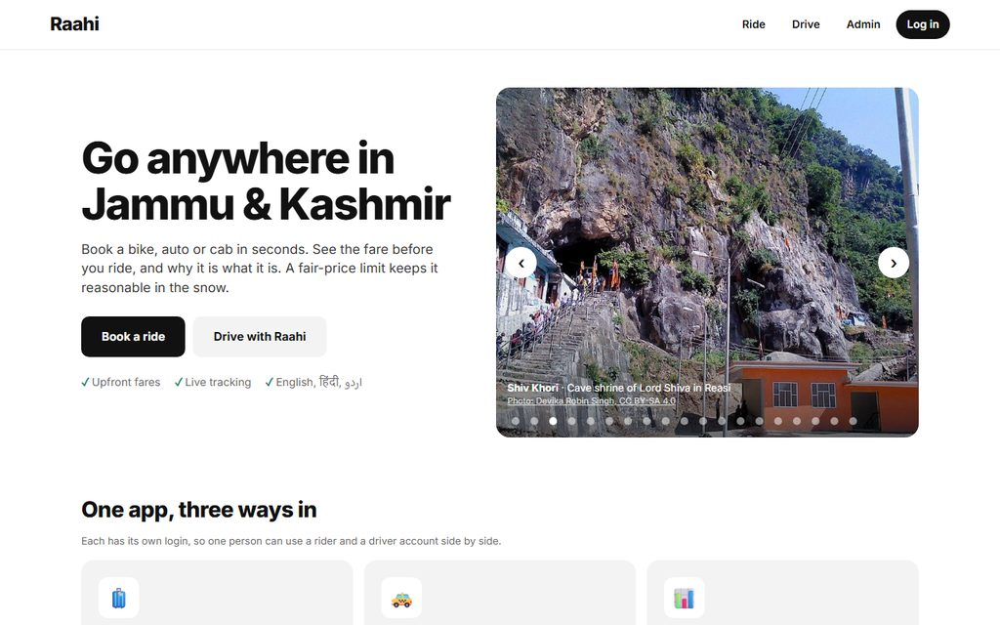
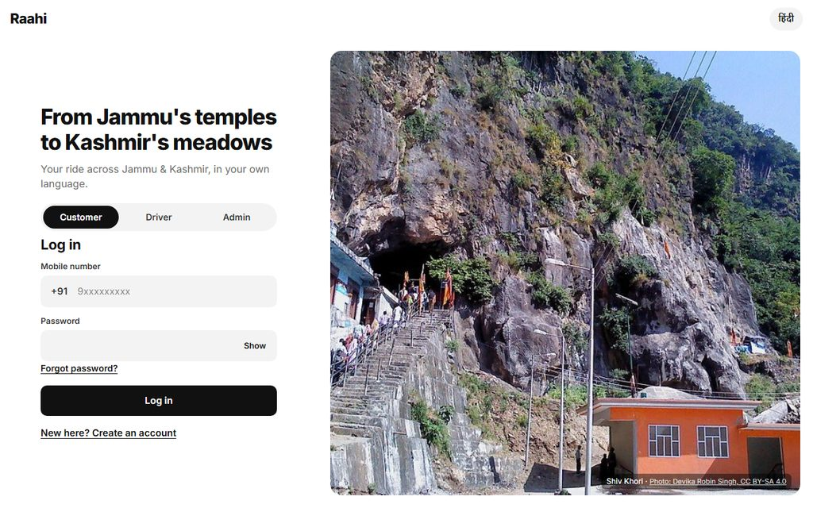
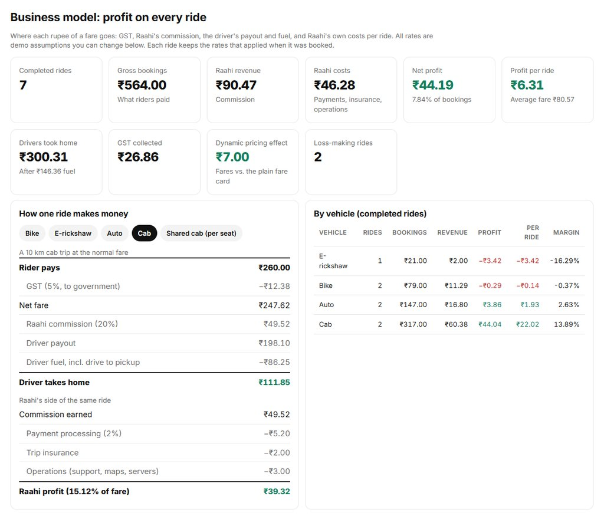

# Raahi: dynamic pricing for rides across Jammu & Kashmir

A working demo of a ride-booking app for J&K, built around a demand-based pricing engine. Riders book
on a live map, get matched to a driver, and can call or chat with them. Every fare says why it costs
what it costs, a fair-price limit stops it rising too far during snow, storms and road closures, and
riders see how it compares with labelled estimates for other apps. A built-in assistant takes bookings
in English, Hindi and Urdu.

**Live demo:** <https://raahi-jk.onrender.com> (a free server: the first visit can take about a minute to wake it)

**Stack:** FastAPI · SQLite / PostgreSQL · WebSockets · Scikit-Learn · Pandas · Leaflet + OpenStreetMap · Brevo email · installable web app (PWA)

**This is a college demo, not a live service.** All market data is synthetic, drivers are simulated
unless a real driver account is online, and payment is demo-only.

| Home page | Customer app | Business model (admin) |
|---|---|---|
|  |  |  |

The business model screenshot comes from a local copy with seven demo rides; every rate in it is an
editable demo assumption, not real company accounts.

## Highlights

| | |
|---|---|
| **Women Raahi** | Verified women riders can choose rides that go only to verified women drivers. Gender comes from the ID document an admin checks, not a tick box. |
| **Help during a ride** | A red Help button for rider and driver: one-tap 112, 108 and 1091, trip sharing, and a live alert to the admin panel. |
| **Driver verification** | ID, driving licence, vehicle RC, number plate and a selfie, reviewed before a driver can go online. Photos are deleted after review. |
| **Fair pricing** | A demand model and optimizer set the fare; a limit caps it, lower during snow, storms and closures. Every fare explains what raised it. |
| **Business model** | The admin panel splits every fare into GST, Raahi's commission, the driver's payout and fuel, and Raahi's own costs, and shows profit per ride and per vehicle. All rates are editable demo assumptions. |
| **Built for J&K** | Regional weather, road closures, yatra seasons, shared cabs, ~16,800 bookable J&K places, and an offline app shell for weak networks. |
| **Booking assistant** | Books by text or voice in English, Hindi and Urdu, and only after the rider says yes. With Sarvam AI it also hears Dogri and Kashmiri. |
| **Email updates** | Welcome emails, "application received" and approval or rejection emails for drivers, and password reset codes. |
| **Tested** | 140+ automated tests run the real app end to end against a throwaway database. |

---

## Run it

```bash
python -m venv .venv
.venv\Scripts\activate            # Windows  (source .venv/bin/activate on Unix)
pip install -r requirements.txt

uvicorn backend.main:app --reload
```

| Page | URL | Who uses it |
|---|---|---|
| Home page | <http://127.0.0.1:8000/> | Photo tour of J&K, and the way into each app |
| Customer app | <http://127.0.0.1:8000/ride> | Sign up, then book a ride |
| Driver app | <http://127.0.0.1:8000/driver> | Sign up, go online, accept rides |
| Admin panel | <http://127.0.0.1:8000/admin> | Set conditions and limits, compare strategies |
| API docs | <http://127.0.0.1:8000/docs> | |

Customer, driver and admin accounts are separate, each with its own password and login. One mobile
number can hold both a customer and a driver account, and both can stay signed in together in one browser.
Nobody can sign up as an admin.

Creating an account does not sign you in: you then log in with your number and password. A login
lasts until the browser tab closes (a reload keeps it), so coming back to the app asks for credentials again.

### Forgot password (email codes)

Sign-up asks for an email address. **Forgot password?** on the login page emails a 6-digit code to
that address; entering the code with a new password changes it and signs out every older session.
Codes last 15 minutes, work once, and lock after 5 wrong tries. The admin password is not reset by
email (set `ADMIN_PASSWORD` instead). Accounts created before this change have no email, so they
cannot use it.

**On Render's free plan, use Brevo.** Render's free instances block the SMTP ports (25, 465, 587),
so Gmail SMTP times out there. Brevo sends over HTTPS instead: make a free account at
[brevo.com](https://www.brevo.com), verify your sender address (Senders & IP > Senders), create an
API key (SMTP & API > API Keys), and set these in the Render dashboard:

```bash
BREVO_API_KEY=xkeysib-...
MAIL_FROM="Raahi <yourname@gmail.com>"   # must be the address you verified in Brevo
```

When `BREVO_API_KEY` is set it is used and the `SMTP_*` settings are ignored.

To send the emails through Gmail SMTP instead (fine locally or on a paid instance), turn on 2-Step Verification for the sending Google account, create
an [App Password](https://myaccount.google.com/apppasswords), and set:

```bash
SMTP_HOST=smtp.gmail.com
SMTP_PORT=587
SMTP_USER=yourname@gmail.com
SMTP_PASSWORD=<16-character app password>
MAIL_FROM="Raahi <yourname@gmail.com>"   # optional
```

Without `BREVO_API_KEY` or `SMTP_HOST` nothing is sent: the server prints each email, code included, to its log, so you
can try the flow locally.

### Emails the app sends

| When | Who | Email |
|---|---|---|
| An account is created | Rider or driver | Welcome. Drivers are told to upload their documents next |
| Documents are uploaded | Driver, or a woman rider for Women Raahi | "We have received your application", while the team reviews it |
| An admin approves or rejects | The same person | The result, with the reason for a rejection (also sent by SMS when SMS is set up) |
| **Forgot password?** | Anyone with an email on their account | A 6-digit code |

Each email goes out as plain text and as HTML under a Raahi header with the logo. The logo loads from
the app itself, at `PUBLIC_URL`, or on Render at the `RENDER_EXTERNAL_URL` Render sets by itself.
Sending never blocks the request: if the mail service is down, signup, document upload and reviews
still work, and the failure is logged as a `[mail]` line.

### Women Raahi and driver verification

Every driver must pass an ID check before going online: an ID document, driving licence, vehicle RC,
number plate and a selfie. An admin compares them by eye in the admin panel and approves or rejects
with a reason. Approval records the gender printed on the document, and the photos are deleted as soon
as the review is done.

Women riders can turn on **Women Raahi** (the pink button in the customer app) after the same ID
check. Their rides then go only to drivers verified as women, and the app switches to a pink theme.
Because gender comes from the checked document, nobody can pick "woman" to get these rides. A real
launch would use DigiLocker or a licensed KYC provider instead of the admin's review.

### Help during a ride

While a ride is live, riders and drivers see a red **Help** button. It offers one-tap calls to 112
(police and emergency), 108 (ambulance) and 1091 (women helpline), sharing the trip details, and a
report to Raahi support with the problem, a note and the phone's location. Reports appear at once in
the admin panel under **Help requests**.

The admin logs in with mobile `6006083467` (change it with `ADMIN_PHONE`). Set the password with
`ADMIN_PASSWORD`: the server applies both on every start, so changing either changes the admin
login. Without `ADMIN_PASSWORD`, a new admin account gets a generated password, printed once.

To see a real driver handle a ride, open the driver app in a second browser profile, go online near
the pickup, and book a matching vehicle. If no real driver accepts, a simulated one takes the ride.

### Accounts that survive restarts (PostgreSQL)

Locally the app stores accounts and rides in `data/app.db` (SQLite). Hosts with a wiped disk,
like Render's free plan, lose that file every time the service sleeps. Set `DATABASE_URL` to a
PostgreSQL connection string (a free [Neon](https://neon.tech) project works) and the app uses
it instead, creating its tables on first start.

Routes follow real roads using the public OSRM server on OpenStreetMap data. Set `OSRM_URL` to
use your own server, or `ROAD_ROUTING=0` to fall back to estimated distances.

### Rebuild the model and results (about 10 minutes)

```bash
python data_pipeline/generate_data.py   # 78,840 rows of synthetic J&K market data
python data_pipeline/train.py           # 3 model families, time-aware cross-validation
python data_pipeline/evaluate.py        # accuracy, elasticity, recovery of the known truth
python data_pipeline/simulate.py        # strategy comparison on the holdout months
python -m unittest discover -s tests    # all tests, using a throwaway database
```

---

## What makes it specific to J&K

| Area | How it is handled |
|---|---|
| **Regions** | Jammu plains, Kashmir valley, and the Chenab & Pir Panjal hills each have their own climate, calendar, road factor and speed |
| **Vehicles** | Bike, e-rickshaw, auto, cab and shared cab, offered only where they fit the region and distance |
| **Weather** | Snow and storms change both demand and how price-sensitive riders are |
| **Road closures** | When a region is closed, trips between regions through it cannot be booked. Local trips continue. Closing the hills blocks Jammu-Srinagar. |
| **Yatra and tourism** | Vaishno Devi Navratri, Amarnath and Machail yatras, and tourist seasons shift demand |
| **Weak networks** | The app shell loads offline and says clearly when booking needs a connection |
| **Language** | Screens in English and Hindi. The assistant also handles Urdu. Dogri and Kashmiri are not included, because they need checking by native speakers |
| **Temples and yatra destinations** | Vaishno Devi, Raghunath Temple, Shiv Khori, Krimchi and other Jammu temples can be booked directly |

---

## How a fare is set

You cannot train a model on "the optimal price", because no such label exists and past prices were not
optimal. So the work is split:

1. **A demand model** answers: at price P, in this context, how many rides?
2. **An optimizer** tries 121 candidate prices and picks the one with the highest `(price - cost) x demand`.
3. **A fair-price limit** caps the result: ×1.30 normally and ×1.15 during snow, storms or closures. Admins can change both.

`fare = (base fare + per-km rate x km) x multiplier`

Sample fares for a 10 km Srinagar cab trip (normal fare ₹260):

| Situation | Model wants | Charged | Fare |
|---|---|---|---|
| 2pm, clear | ×1.04 | ×1.04 | ₹270 |
| 6pm, clear | ×1.21 | ×1.21 | ₹314 |
| 6pm, snowing | ×1.30 | ×1.15 (limited) | ₹299 |

The last row is the point of the limit. Snow makes riders less price-sensitive, so a pure profit
optimizer charges most when people have the fewest alternatives. Here the limit saves the rider ₹39.

**Why this fare?** The app re-prices the trip with each active condition switched off and shows the
rupee difference, before the limit is applied. These effects can overlap, so they need not add up to the total.

### The booking assistant

The chat button in the customer app understands ride requests in English, Hindi, Urdu and Roman
Hindi/Urdu, such as `मुझे जम्मू से कटरा जाना है`, `مجھے جموں سے کٹرہ جانا ہے` or `jammu se katra cab`.
It asks for anything missing, shows the fare, and **books only after the rider says yes**. It can also
report on the current ride, cancel it after confirming, and show Jammu's temples.

**Voice:** riders can tap the microphone, choose a language and speak, and the assistant reads its
replies aloud. Spoken commands cover booking, the current ride's status, cancelling, calling the driver,
past trips and Jammu's temples. A spoken booking still needs an explicit yes. Voice uses the browser's
built-in speech features, so it needs Chrome or Edge to listen, may send audio to the browser's speech
service, and on a phone needs HTTPS. Reading Urdu aloud depends on the device having an Urdu voice;
without one, replies stay as text.

**Voice through Sarvam AI (optional):** set `SARVAM_API_KEY` (a key from
[dashboard.sarvam.ai](https://dashboard.sarvam.ai)) and the app records the rider and the server sends
the recording to Sarvam's Saaras model, which also understands **Dogri and Kashmiri**, works in any
browser, and tells languages apart by itself (the picker adds डोगरी and کٲشُر). Sarvam's Bulbul voices
read Hindi and English replies aloud; Urdu replies are still read by the device, or shown as text. The
key never reaches the browser. Each rider gets `VOICE_DAILY_LIMIT` Sarvam calls a day (default 80), and
if Sarvam is missing, failing or over the limit, the app falls back to the browser's speech. The
assistant's rules understand English, Hindi and Urdu, so Dogri and Kashmiri requests work as far as
their words and place names overlap with Hindi and Urdu.

**Addresses:** riders can name a neighbourhood or lane, such as `bharat nagar talab tillo se roop nagar`,
or say `meri current location se`, in which case the browser asks for permission and shares the position.
`mera ghar ... mein hai` saves a home for `ghar chalo`. Places are looked up in this order: the J&K towns,
a list of Jammu and Srinagar neighbourhoods with Hindi and Urdu names, about 16,800 named J&K places from OpenStreetMap
stored in the app (villages, hamlets, temples, mosques, hospitals, schools, markets, malls, chowks, petrol pumps, banks, bus stops, stations and tourist spots, built by `data_pipeline/build_places.py`, which also saves the J&K boundary so any pin inside it can be booked),
then OpenStreetMap's Nominatim service, which receives the typed address. Words are matched by their consonants, so
`bawe wali maat`, `बावे वाली माता` and `باوے والی ماتا` find the same temple. A rider can also ask `bawe wali mata kahan hai`
or `sabse sasta batao`. A result is rejected unless it contains the words asked for, since
Nominatim answers "Bharat Nagar, Jammu" with Jammu Airport. If nothing genuine is found, the assistant says so
and offers the map rather than guessing. A rider's extra words stay on the ride, so the driver sees the full address.

**Conversation:** the assistant greets riders by name, remembers their home and last trip, asks one thing at a
time, and speaks amounts and distances as words. After a spoken question it listens again by itself, except at
the booking question, which needs a tap on the mic so that background noise can't be heard as a yes.

It runs on written rules in `backend/chatbot.py`, not an AI model. That means no API key, no cost per
message, and no messages sent to an outside service, and every behaviour can be tested exactly. The
limit is that it understands ride-booking language, not open conversation. Anything else gets a help message.

### Comparing fares with other apps

For local trips, the app shows its confirmed fare beside ranges labelled "Estimate" for Rapido and Uber,
and recommends one. It names a rival only when that rival's whole range is below our fare. Otherwise it
says it is too close to call, and links to each company's site for the real price.

**These estimates are not Rapido or Uber prices.** No current J&K rates or open fare feed were found for
either company, so the rates are assumptions that an admin can edit, and they exclude any surge. Whether
each service runs on a given route is also unconfirmed. To use real figures, replace the rates in the
admin panel with fares read from their apps.

The same estimates feed the pricing engine as rival prices, limited to the range it was trained on, so
a cheaper rival pulls our optimal fare down.

---

## Results

### Demand model

Tested on the last 20% of the year (19 Oct - 30 Dec), which was never used for training or model choice.

| Model | RMSE (rides/hour) | R² | Elasticity | Error vs. truth | |
|---|---|---|---|---|---|
| **Ridge regression** | **7.70** | **0.950** | **−1.98** | **0.01** | **selected** |
| Histogram gradient boosting | 10.58 | 0.906 | −1.68 | 0.29 | |
| Random forest | 13.64 | 0.844 | −0.82 | 1.14 | fails recovery |
| Baseline (mean demand) | 34.59 | −0.003 | | | |

Models must first show a downward-sloping demand curve, then the winner is chosen on cross-validation,
never on the test set. Because the data is synthetic, the true elasticity is known, so the estimate can be checked:

| Segment | Estimated | True | Error |
|---|---|---|---|
| Rush hour | −1.86 | −1.82 | 0.05 |
| Off-peak (22-05) | −2.09 | −2.09 | 0.00 |
| Raining | −1.91 | −1.86 | 0.06 |
| Dry | −1.99 | −2.00 | 0.01 |
| Snowing | −2.07 | −1.85 | **0.22** |

Row-level agreement with the truth: r = 0.62, mean absolute error 0.10.

### Do the pricing strategies work?

The simulator adds what the demand model cannot see: drivers, waiting and cancellations. Each strategy
prices 15,768 market-hours over 10 seeded runs, under the same fair-price limits.

| Strategy | Profit vs. fixed fares | Below best possible | Rides | Avg wait (min) |
|---|---|---|---|---|
| Fixed fares | 0% | 13.9% | 768,731 | 9.5 |
| Learning bandit | +6.0% ± 0.2 | 8.7% | 701,274 | 8.4 |
| Demand model | +8.9% ± 0.1 | 6.2% | 787,114 | 7.7 |
| Rule-based surge | +10.5% ± 0.1 | 4.8% | 746,905 | 6.5 |
| Oracle (upper bound) | +16.1% ± 0.1 | 0% | 719,188 | 5.0 |

**The main finding:** a simple rule that reacts to last hour's demand/supply pressure beats the far
more accurate demand model on profit, likely because the model cannot see drivers. The demand model
completes the most rides, the rule cuts waits more. The bandit is weakest here: it has no prior
knowledge and pays to explore during the 10-week window.

These numbers compare strategies inside this model of a market. The supply and cancellation values
in `simulate.py` are assumptions, so **this is not a forecast of real J&K earnings.**

---

## Why the data is built with traps

The generator includes three problems real pricing data has, because a dataset without them proves little:

- **Endogeneity:** the firm raises prices when demand is high, so a naive fit is badly wrong. Measured here: naive elasticity +0.19 against a true −1.96 ("raising prices sells more"), and −2.03 once the drivers are controlled for correctly.
- **Identification:** promos and price tests provide the independent price variation any estimate depends on.
- **Count noise:** demand is drawn from a Poisson distribution, as real counts behave.

---

## Layout

```
data_pipeline/
  config.py         ground truth, regions, products, assumptions
  season.py         J&K festival, yatra and tourism calendar
  generate_data.py  synthetic market with the three traps
  features.py       features shared by training and the live engine
  train.py          model training with time-aware cross-validation
  evaluate.py       accuracy, elasticity, recovery of the truth, model selection
  simulate.py       marketplace simulator and strategy comparison
backend/
  engine.py         demand curve + optimizer
  fares.py          fare card, fair-price limit, fare explanations
  places.py         J&K towns, service area, route estimates
  rides.py          accounts, quotes, dispatch, tracking, chat, assistant, admin
  chatbot.py        language detection, request parsing, replies in four language forms
  appdb.py          SQLite storage and password hashing
  main.py           FastAPI app
frontend/
  home.*                       home page
  rider.*, driver.*, admin.*   the three apps
  chat.js                      booking assistant
  common.js, app.css, sw.js    shared code, styles, offline shell
  photos/                      J&K photos and their credits (photos.json)
  index.html                   pricing dashboard
tests/              unit, API and end-to-end ride tests
```

---

## Deploying

`render.yaml` deploys the Docker image to Render. Set `ADMIN_PASSWORD` in the Render dashboard.

- **Set `DATABASE_URL`, or data does not survive.** Render's free disk is wiped on every deploy and every time the service sleeps, so without a hosted PostgreSQL database (a free [Neon](https://neon.tech) project works) accounts and rides reset. See [Accounts that survive restarts](#accounts-that-survive-restarts-postgresql).
- **Email:** set `BREVO_API_KEY` and `MAIL_FROM` (see [Forgot password](#forgot-password-email-codes)). The free plan blocks SMTP.
- **Don't use `vercel.json` for this app.** Vercel's serverless functions don't suit the WebSockets and running trips the ride app depends on.
- The model is committed, and `scikit-learn` is pinned to the version that saved it.

---

## Honest limitations

- **All data is synthetic.** Fares, climate, demand behaviour and rival prices are assumptions. Nothing here was measured from real J&K rides. Accuracy results show the method can recover a known truth, not that it would match real riders.
- **Ridge winning is partly built in.** The generator's demand equation is log-linear, which is exactly the shape Ridge fits. On real data trees often do better.
- **Snow is the weakest estimate.** Its elasticity error is 0.22, against 0.06 or less elsewhere. It has few training rows.
- **Live festival pricing covers fixed-date holidays only.** Most festivals move each year, and the app has no calendar of future dates, so they don't raise live fares.
- **Yatra pricing is untested on holdout data.** No yatra falls inside the holdout months, so that effect is not measured there.
- **Routes are estimates.** Distance is straight-line times a terrain factor, and the map line does not follow roads. Town coordinates are approximate, and the service-area check can be wrong near borders.
- **Rival prices are assumptions**, so a recommendation to use or avoid a rival is only as good as those rates. Check the real fare before relying on one.
- **Photos are licensed separately** from the code. They come from Wikimedia Commons, were resized, and need their credit kept with them. A few places have no photo of their own, so the app shows a nearby landmark and says which one it is. Two Raghunath area pictures are historic photos, and free photos of some temples such as Ranbireshwar and Peer Kho were not available.
- **Address coverage is limited.** Coverage follows OpenStreetMap, which has gaps, so not every lane or shrine in J&K is known, and pins mark a place or area, not a house. Riders can always drop a pin. Map data is © OpenStreetMap contributors (ODbL).
- **Current location is only as good as the device.** Phones with GPS are close; laptops can be far off, and a phone needs HTTPS for it.
- **Voice quality depends on the device.** The app picks the best voice installed and uses no paid speech service, so it sounds more natural where neural or online voices exist.
- **The assistant's Hindi and Urdu were not checked by native speakers**, and its coordinates for temples are approximate.
- **Simulated trips run at demo speed**, under a minute whatever the distance. Real drivers report location only when they set it in the app.
- **Before any real launch** this would need OTP login, rate limiting, real payments, driver verification, insurance, the required permits, a hosted database and legal review of the pricing rules.
